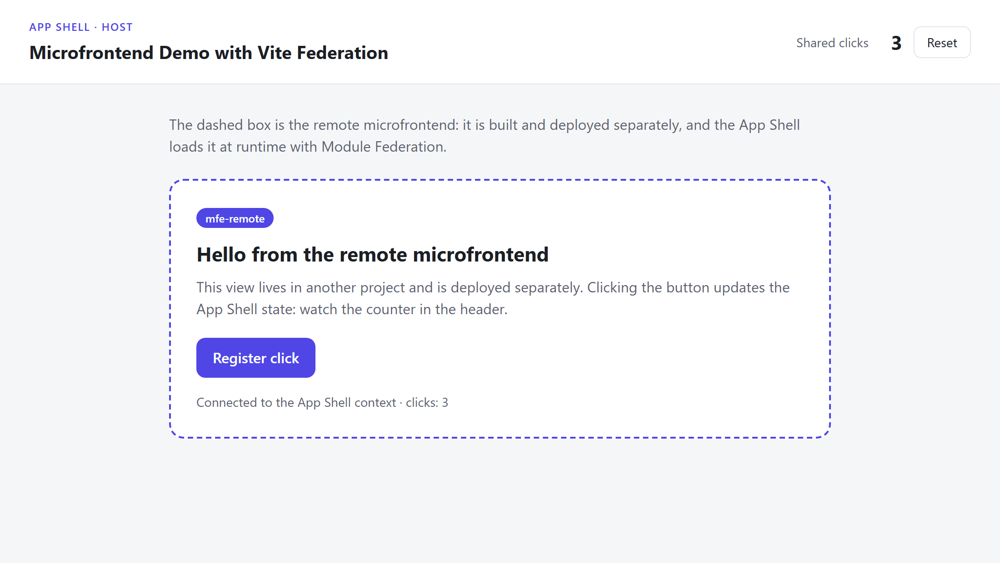
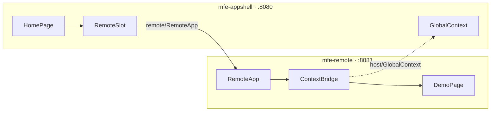

# Microfrontend Archetype · React + Vite + Atomic Design

[](https://react.dev/)
[](https://vite.dev/)
[](https://www.typescriptlang.org/)
[](LICENSE)

[English](README.md) · **Español**

Arquetipo de microfrontends con React 19, Vite 7, Module Federation y Atomic Design. Tiene dos
proyectos independientes, cada uno con sus dependencias, pruebas, imagen Docker y Makefile:

- **mfe-appshell**: el App Shell (host). Orquesta la aplicación y carga los microfrontends.
- **mfe-remote**: un microfrontend remoto. Expone una vista que el App Shell carga en tiempo de
  ejecución.

La contraparte backend es el
[arquetipo de microservicio](https://github.com/ingnatoz/microservice-archetype-java-spring) con
Java y Spring Boot.



---

## Arquitectura



- El App Shell descarga el `remoteEntry.js` del remoto al renderizar. Un despliegue nuevo del
  remoto se ve sin recompilar el App Shell.
- El remoto usa el estado del App Shell. Si corre solo o el App Shell no responde, usa un
  contexto local.
- React se comparte como una sola instancia. Si el remoto falla, el App Shell muestra un aviso y
  sigue funcionando.
- Los estilos son CSS Modules con un prefijo por proyecto, así las clases del remoto no chocan
  con las del App Shell.

---

## Estructura del proyecto

```
📦 microfrontend-archetype-react-vite
├── 📁 .claude                        # Claude Code: reglas, /verify, skill y agente revisor
├── 📁 docs                           # Captura de la demo
├── 📁 mfe-appshell                   # App Shell (host) · puerto 8080
│   ├── 📁 Docker                     # Dockerfile, compose.yml y nginx
│   ├── 📁 src
│   │   ├── 📁 components             # Atomic Design
│   │   │   ├── 📁 atoms              # Button, Eyebrow
│   │   │   ├── 📁 molecules          # ClickCounter, ErrorMessage
│   │   │   ├── 📁 organisms          # AppHeader, RemoteSlot
│   │   │   └── 📁 templates          # ShellLayout
│   │   ├── 📁 context                # Estado global (se expone como host/GlobalContext)
│   │   ├── 📁 hooks                  # Hooks personalizados
│   │   ├── 📁 pages                  # Vistas de nivel página
│   │   ├── 📁 styles                 # Tokens de diseño y estilos globales
│   │   ├── 📁 types                  # Contratos de los módulos federados
│   │   ├── 📄 App.tsx                # Componente raíz
│   │   └── 📄 main.tsx               # Punto de entrada de React
│   ├── 📁 tests                      # Pruebas con la misma estructura que src
│   ├── 📄 .oxlintrc.json             # Reglas del linter
│   ├── 📄 Makefile                   # Todos los comandos del proyecto
│   ├── 📄 package.json
│   ├── 📄 tsconfig.json              # Referencia a tsconfig.app.json y tsconfig.node.json
│   └── 📄 vite.config.ts             # Module Federation
├── 📁 mfe-remote                     # Microfrontend remoto · puerto 8081
│   ├── 📁 Docker
│   ├── 📁 src
│   │   ├── 📁 components
│   │   │   ├── 📁 atoms              # Button, Tag
│   │   │   ├── 📁 molecules          # ConnectionStatus
│   │   │   ├── 📁 organisms          # DemoCard
│   │   │   └── 📁 templates          # RemoteLayout
│   │   ├── 📁 context                # ContextBridge: estado del App Shell o local
│   │   ├── 📁 hooks                  # Hooks personalizados
│   │   ├── 📁 pages                  # Vistas de nivel página
│   │   ├── 📁 styles                 # Estilos del modo standalone
│   │   ├── 📁 types                  # Contrato de host/GlobalContext
│   │   ├── 📄 RemoteApp.tsx          # Módulo expuesto como remote/RemoteApp
│   │   └── 📄 main.tsx               # Arranque standalone
│   ├── 📁 tests
│   └── 📄 Makefile, package.json, ... # Misma configuración que mfe-appshell
└── 📄 CLAUDE.md                      # Contexto del proyecto para Claude Code
```

Los componentes siguen Atomic Design: átomos, moléculas, organismos, templates y páginas. Solo
las páginas leen el estado; los demás componentes reciben props.

---

## 🛠️ Requisitos

- Node.js 20.19+ (recomendado 24) y npm
- Make
- Docker (opcional)

---

## Uso

- Cada proyecto se instala y se ejecuta por separado, desde su carpeta.
- Todos los comandos están en su Makefile: `make help` los muestra.
- `mfe-remote`: `make install` y `make start` (http://localhost:8081).
- `mfe-appshell`: `make install` y `make start` (http://localhost:8080).
- Con Docker: `make docker-up` en lugar de `make start`.

---

## 🤖 Desarrollo con IA

El repositorio incluye configuración para [Claude Code](https://code.claude.com/docs):

- `CLAUDE.md`: contexto del proyecto (arquitectura, comandos y contratos).
- `.claude/rules`: convenciones de código.
- `/verify`: comando que ejecuta lint, tipos, pruebas y build en los dos proyectos.
- `atomic-component`: skill para crear componentes con Atomic Design.
- `code-reviewer`: agente que revisa los cambios contra las convenciones.

---

## Recursos adicionales

- Module Federation: [@originjs/vite-plugin-federation](https://github.com/originjs/vite-plugin-federation)
- Atomic Design: [libro de Brad Frost](https://atomicdesign.bradfrost.com/)
- React: [Documentación oficial](https://react.dev/)
- Vite: [Documentación oficial](https://vite.dev/)
- Docker: [Documentación oficial](https://docs.docker.com/)

---

## 📄 Licencia

[MIT](LICENSE)
