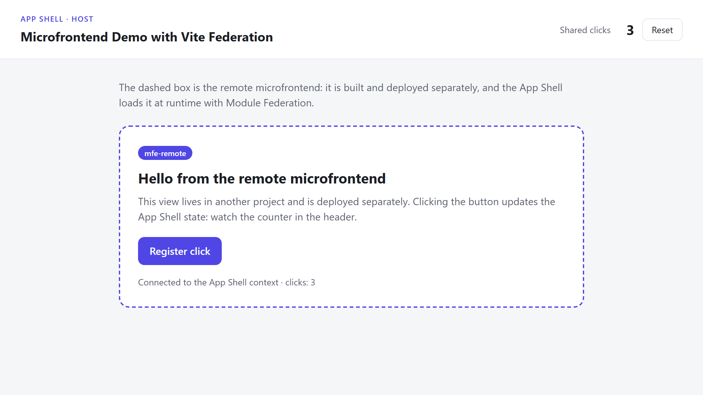
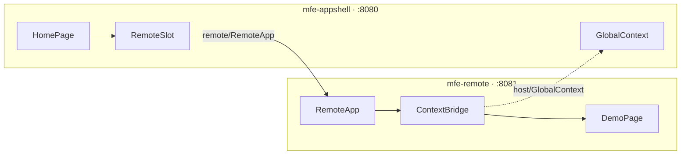

# Microfrontend Archetype · React + Vite + Atomic Design

[](https://react.dev/)
[](https://vite.dev/)
[](https://www.typescriptlang.org/)
[](LICENSE)

**English** · [Español](README.es.md)

Microfrontend archetype with React 19, Vite 7, Module Federation and Atomic Design. It has two
independent projects, each with its own dependencies, tests, Docker image and Makefile:

- **mfe-appshell**: the App Shell (host). It orchestrates the application and loads the
  microfrontends.
- **mfe-remote**: a remote microfrontend. It exposes a view that the App Shell loads at runtime.

The backend counterpart is the
[microservice archetype](https://github.com/ingnatoz/microservice-archetype-java-spring) with Java
and Spring Boot.



---

## Architecture



- The App Shell downloads the remote's `remoteEntry.js` when it renders. A new deployment of the
  remote shows up without rebuilding the App Shell.
- The remote uses the App Shell state. If it runs alone or the App Shell does not respond, it uses
  a local context.
- React is shared as a single instance. If the remote fails, the App Shell shows a notice and
  keeps working.
- Styles are CSS Modules with a per-project prefix, so the remote's classes do not clash with the
  App Shell's.

---

## Project structure

```
📦 microfrontend-archetype-react-vite
├── 📁 .claude                        # Claude Code: rules, /verify, skill and reviewer agent
├── 📁 docs                           # Demo screenshot
├── 📁 mfe-appshell                   # App Shell (host) · port 8080
│   ├── 📁 Docker                     # Dockerfile, compose.yml and nginx
│   ├── 📁 src
│   │   ├── 📁 components             # Atomic Design
│   │   │   ├── 📁 atoms              # Button, Eyebrow
│   │   │   ├── 📁 molecules          # ClickCounter, ErrorMessage
│   │   │   ├── 📁 organisms          # AppHeader, RemoteSlot
│   │   │   └── 📁 templates          # ShellLayout
│   │   ├── 📁 context                # Global state (exposed as host/GlobalContext)
│   │   ├── 📁 hooks                  # Custom hooks
│   │   ├── 📁 pages                  # Page-level views
│   │   ├── 📁 styles                 # Design tokens and global styles
│   │   ├── 📁 types                  # Federated module contracts
│   │   ├── 📄 App.tsx                # Root component
│   │   └── 📄 main.tsx               # React entry point
│   ├── 📁 tests                      # Tests with the same structure as src
│   ├── 📄 .oxlintrc.json             # Linter rules
│   ├── 📄 Makefile                   # Every project command
│   ├── 📄 package.json
│   ├── 📄 tsconfig.json              # References tsconfig.app.json and tsconfig.node.json
│   └── 📄 vite.config.ts             # Module Federation
├── 📁 mfe-remote                     # Remote microfrontend · port 8081
│   ├── 📁 Docker
│   ├── 📁 src
│   │   ├── 📁 components
│   │   │   ├── 📁 atoms              # Button, Tag
│   │   │   ├── 📁 molecules          # ConnectionStatus
│   │   │   ├── 📁 organisms          # DemoCard
│   │   │   └── 📁 templates          # RemoteLayout
│   │   ├── 📁 context                # ContextBridge: App Shell or local state
│   │   ├── 📁 hooks                  # Custom hooks
│   │   ├── 📁 pages                  # Page-level views
│   │   ├── 📁 styles                 # Standalone mode styles
│   │   ├── 📁 types                  # host/GlobalContext contract
│   │   ├── 📄 RemoteApp.tsx          # Module exposed as remote/RemoteApp
│   │   └── 📄 main.tsx               # Standalone entry point
│   ├── 📁 tests
│   └── 📄 Makefile, package.json, ... # Same setup as mfe-appshell
└── 📄 CLAUDE.md                      # Project context for Claude Code
```

Components follow Atomic Design: atoms, molecules, organisms, templates and pages. Only pages
read the state; the other components receive props.

---

## 🛠️ Requirements

- Node.js 20.19+ (24 recommended) and npm
- Make
- Docker (optional)

---

## Usage

- Each project is installed and run separately, from its own folder.
- Every command is in its Makefile: `make help` lists them.
- `mfe-remote`: `make install` and `make start` (http://localhost:8081).
- `mfe-appshell`: `make install` and `make start` (http://localhost:8080).
- With Docker: `make docker-up` instead of `make start`.

---

## 🤖 AI-assisted development

The repository includes configuration for [Claude Code](https://code.claude.com/docs):

- `CLAUDE.md`: project context (architecture, commands and contracts).
- `.claude/rules`: code conventions.
- `/verify`: command that runs lint, type checks, tests and build in both projects.
- `atomic-component`: skill to create components with Atomic Design.
- `code-reviewer`: agent that reviews changes against the conventions.

---

## Additional resources

- Module Federation: [@originjs/vite-plugin-federation](https://github.com/originjs/vite-plugin-federation)
- Atomic Design: [Brad Frost's book](https://atomicdesign.bradfrost.com/)
- React: [Official documentation](https://react.dev/)
- Vite: [Official documentation](https://vite.dev/)
- Docker: [Official documentation](https://docs.docker.com/)

---

## 📄 License

[MIT](LICENSE)
